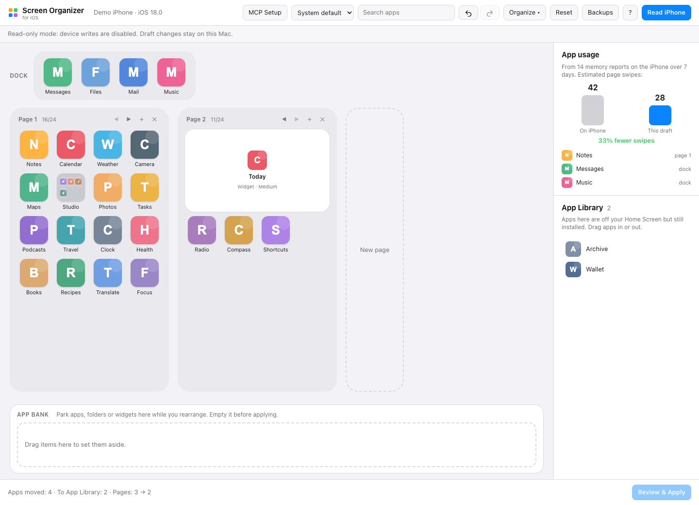

<div align="center">

<h1>Homescreen</h1>
<p><strong>Arrange your iPhone or iPad Home Screen from your Mac.</strong></p>

**Original project by Jonathan Kats · Fork of [kats1123/homescreen-mcp](https://github.com/kats1123/homescreen-mcp).**

[](LICENSE)
[](macapp/BUILDING.md)
[](macapp/BUILDING.md)

**English** · [简体中文](README.zh-CN.md)

[Install](#install) · [Get started](#get-started) · [Compatibility](#compatibility) · [Optional MCP](#mcp) · [Report an issue](https://github.com/worldsavepoint/homescreen-mcp/issues)

</div>

Drag and drop real app icons, arrange folders and widgets, sort by color or usage, and review a layout before applying it over USB. Homescreen includes a Mac app, a browser editor, a CLI and an optional MCP server for AI assistants. Free and open source; no account or jailbreak required.

This fork maintains changes to device sessions, backups, the local editor and the macOS launcher. The original app, interface and SpringBoard research are the work of **Jonathan Kats and upstream contributors**. This fork is independently maintained.

<picture>
  <source media="(prefers-color-scheme: dark)" srcset="docs/app-dark.png">
  
</picture>

<p align="center"><sub>Interface screenshots from the upstream Homescreen project by Jonathan Kats.</sub></p>

<a id="features"></a>

## ✨ What you can do

- **Arrange visually:** drag real icons, folders, widgets and dock items across pages. Use multi-select, search, undo/redo and ⌥-drop to swap items.
- **Organize in one click:** sort by color, A–Z, App Store category or app usage, with an estimate of page swipes saved.
- **Keep a working area:** park items in the App Bank, add/move/delete pages, and edit folders with multiple pages.
- **Manage the App Library:** move apps into or out of it. Homescreen infers its contents from installed apps and the visible layout.
- **Review and apply:** compare the draft, save a device-specific backup before a write, and read back the result. Exported widget settings are included in comparisons.
- **Choose your interface:** Mac app, local browser editor, CLI or 30 MCP tools. Drafts and backups are kept separately for each device.

<a id="fork-updates"></a>

## 🔧 Changes in this fork

- **Read-only sessions:** `HOMESCREEN_READ_ONLY=1` lets you read and edit a local draft while Apply and Restore are disabled in the editor, CLI and MCP session.
- **Device and backup handling:** Apply and Restore refresh the device identity and layout, record backup provenance, and check the result. An interrupted or mismatching result requires a new explicit Read; legacy backups without device provenance cannot be restored by this fork.
- **Local editor and launcher:** authenticated editor sessions, backend health checks and launcher URL/request validation. See the [local editor API reference](docs/LOCAL-EDITOR.md).
- **Source builds:** pinned, hash-checked Python wheels for macOS arm64 / Python 3.12. See [build instructions](macapp/BUILDING.md).

<a id="install"></a>

## 📦 Install from source

Use an **Apple silicon Mac with macOS 14+ and Python 3.12**. Connect an iPhone or iPad over USB and trust the Mac on the device. The commands below use the dependency lock for **macOS arm64 / CPython 3.12**; other platforms need a separately resolved and tested lock.

```sh
git clone --branch fix/safety-and-readonly-ios18 --single-branch https://github.com/worldsavepoint/homescreen-mcp.git
cd homescreen-mcp
python3.12 -m venv .venv
.venv/bin/python -m pip install --require-hashes --only-binary=:all: -r requirements-build.lock
.venv/bin/python -m pip install --no-deps --no-build-isolation -e .
.venv/bin/python -m pip check
```

Start the browser editor in read-only mode:

```sh
HOMESCREEN_READ_ONLY=1 .venv/bin/homescreen ui
```

### Build the Mac app

With Python 3.12 and compatible Xcode command-line tools installed, run from the repository root:

```sh
macapp/build.sh
```

The script creates the app and a DMG in `build/`, using its own fresh Python environment and the same dependency lock. It uses **ad-hoc signing**; the output is not Developer ID signed or notarized. See [macOS build and signing details](macapp/BUILDING.md).

**This fork has no published release DMG yet.** [Upstream releases](https://github.com/kats1123/homescreen-mcp/releases) are published by the original project and do not include this fork's changes.

<a id="get-started"></a>

## 🚀 Get started

1. Launch the editor, connect your iPhone or iPad by USB, and unlock it. Tap **Trust** if asked.
2. Select your device and click **Read** to load its current layout.
3. Drag items, use a sorting action, or park items in the **App Bank** while arranging. Changes stay in the local draft until applied.
4. Review the layout comparison. In a read-only session, keep exploring and editing the draft; Apply and Restore are disabled.

For a normal session, start `.venv/bin/homescreen ui` without `HOMESCREEN_READ_ONLY=1`, or open the built Mac app. **Review & Apply** then writes the reviewed draft to the device after saving a backup. Device checks are listed in [compatibility](#compatibility).

Before applying a layout, **unhide hidden Home Screen pages on the device**: long-press the Home Screen and tap the page dots. USB does not report hidden pages or gaps created on the device. Recreate those gaps in Homescreen if you want to keep them. See [USB layout details](#usb-details).

### Sort by app usage

- **Device reports:** periodic iOS memory reports provide an estimate of app usage without setup. Apps that stay resident for calls or every day receive less weight, because residency is not the same as opening an app.
- **Screen Time:** enable *Settings → Screen Time → Share Across Devices* on both the device and Mac. Reading the synced history needs **Full Disk Access** for Homescreen, or for the Terminal running it, in *System Settings → Privacy & Security*.

### CLI

After installation, use `.venv/bin/homescreen --help` for commands:

```text
read · show · diff · preview · apply · backups · restore · diagnose · probe · ui
```

For a read compatibility report on one already trusted USB device:

```sh
HOMESCREEN_READ_ONLY=1 .venv/bin/homescreen diagnose
```

This reports version and aggregate layout counts without creating a draft.

<a id="compatibility"></a>

## 📱 Compatibility

- **Upstream reports:** iOS 27.0.1 on iPhone 17 Pro Max, iOS 26.6.2 on iPhone 17 Pro, iPadOS 26.6.2 on iPad Air 13″, and the iOS 27.2 simulator. These are upstream's reported checks, not additional device checks by this fork.
- **iPad:** grid, dock and folder capacities come from the device. Upstream reports arranging through MCP/CLI and rendering the iPad grid in the editor; widget pages are accepted when they retain the shape supplied by iPadOS.
- **Python:** package metadata permits Python 3.11+, while this fork's supplied build lock targets Python 3.12 on macOS arm64. Intel Macs require a separately resolved and tested lock.

USB does not export the complete App Library, existing gaps, hidden page state or every widget setting. Keep an archived device backup before applying a layout.

<a id="mcp"></a>

## 🔌 Optional: use an AI assistant

MCP lets an assistant inspect, rearrange, sort and explain your layout. For Claude Code with the Mac app, choose **Device → Copy MCP Setup Command**. It points at the engine bundled in your app:

```sh
claude mcp add homescreen -- /Applications/Homescreen.app/Contents/Resources/engine/engine mcp
```

For the Python installation, run this command from the repository root to use the executable in your virtual environment:

```sh
claude mcp add homescreen -- "$PWD/.venv/bin/homescreen-mcp"
```

For Claude Desktop's `claude_desktop_config.json`, replace `/path/to/homescreen-mcp` with your checkout's absolute path:

```json
{
  "mcpServers": {
    "homescreen": {
      "command": "/path/to/homescreen-mcp/.venv/bin/homescreen-mcp",
      "env": { "HOMESCREEN_READ_ONLY": "1" }
    }
  }
}
```

Try *“organize my apps by color”* or *“put my most-used apps on page 1.”* The assistant edits a draft. In a normal session, you apply it through the editor or `homescreen apply <token>`. Assistant-initiated writes require `HOMESCREEN_ALLOW_APPLY=1`; `HOMESCREEN_READ_ONLY=1` keeps Apply and Restore disabled.

<a id="usb-details"></a>

## 🧠 How it works

[pymobiledevice3](https://github.com/doronz88/pymobiledevice3) communicates over USB: `com.apple.springboardservices` reads layouts and icons, and `installation_proxy` reads installed apps. The editor runs on `127.0.0.1` with authenticated local sessions. Drafts, backups and icon caches are stored in `~/Library/Application Support/homescreen-mcp`.

The optional **Group by App Store category** action asks before sending bundle IDs to Apple's public lookup API and caches the results. Screen Time history is read locally from synced Biome `App.InFocus` streams. Page-swipe estimates count page *N* as *N−1* swipes, plus folder pages, with the dock free.

<details>
<summary><strong>App Library and widget research — from the upstream project</strong></summary>

Jonathan Kats's upstream investigation traced SpringBoard's import path in the iOS 27.2 simulator and checked behavior on real devices:

1. USB `getIconState` returns `[dock, page 1, page 2, …]`, without the App Library, in any format version examined.
2. `setIconState` reaches `-[SBIconController importIconState:]`. `+[SBIconStateArchiver rootArchiveFromITunesRepresentation:]` converts that list into only `buttonBar` and `iconLists`.
3. Apps omitted from that list can be placed onto Home Screen pages. Upstream observed 33 App Library apps moving onto the Home Screen after writing an unchanged list.

Homescreen instead sends SpringBoard's dictionary form: `buttonBar`, `iconLists` and `ignored` for App Library items. It infers `ignored` from installed apps, including offloaded apps, minus apps on the Home Screen and hidden/system-only apps. App and folder data and unknown fields are retained as items move.

**Widgets:** configuration is associated with an element ID exported as `userSelectedElementIdentifier`. Homescreen sends it back as `uniqueIdentifier` and remembers IDs across reads. Upstream verified a Scriptable widget retained its selected script after a write on iOS 27.0.1. Settings absent from the USB export cannot be compared.

**Web clips:** the installed-app list does not include them, and USB does not report App Library web clips. Homescreen remembers clips it has seen per device and includes them in `ignored`. If an unseen clip appears after a write, the result names it under `hidden_webclips`; upstream documented moving it back to the App Library and applying again on iOS 26.6.2.

The upstream implementation omits Today View and page-ID keys where their existing device values should be retained. Its simulator harness is in [`tools/sbhelper/`](tools/sbhelper/README.md). See the [upstream project](https://github.com/kats1123/homescreen-mcp) for the original research.

</details>

<details>
<summary><strong>Gaps, hidden pages and layout validation</strong></summary>

iOS stores pinned empty cells in `listMetadata` → `fixedLocations`, keyed by page ID. USB layout exports return icon order but omit these gaps and hidden-page state. A write without gap metadata clears gaps, including those on pages that were not edited.

- Homescreen remembers gaps created in its editor per device and sends their page IDs and pins with writes. Upstream checked this on iOS 27.0.1 and the iOS 27.2 simulator.
- Gaps made on the device cannot be read and close on the first apply. Recreate them by dropping an app on the desired empty spot in the editor.
- Unhide Home Screen pages before applying, because USB does not expose which are hidden.

Validation checks page/dock/folder capacities, item duplication or loss, nested folders/widgets, and an empty App Bank. On iPhone, a 4×6 page has 24 slots; small/medium/large widgets take 4/8/16, the dock holds 4, and folders hold 9 per page. iPads provide their own capacities; upstream's iPad Air 13″ reported a 5×6 grid, 26 dock apps and 16 items per folder page.

System apps that iOS never displays on the Home Screen are listed in `NEVER_ON_HOME_SCREEN` in [`homescreen/device.py`](homescreen/device.py). An unexpected system app reported as `added_by_ios` may require updating that list.

</details>

<a id="development"></a>

## 🛠️ Development

Use the source installation above, then run the repository checks:

```sh
.venv/bin/python -m pytest -q tests
```

Explore the editor with a fixture:

```sh
.venv/bin/python tests/fake_phone.py fake.plist --dict
HOMESCREEN_FIXTURE=fake.plist .venv/bin/homescreen ui
```

Or use a booted simulator:

```sh
HOMESCREEN_SIM=booted .venv/bin/homescreen ui
```

References: [macOS builds and dependency lock](macapp/BUILDING.md) · [local editor sessions and API](docs/LOCAL-EDITOR.md) · [compatibility checks](docs/COMPATIBILITY.md).

<a id="credits"></a>

## 🤝 Credits and support

**Jonathan Kats** created Homescreen. Credit for the original Mac app, editor, screenshots and SpringBoard investigation belongs to the [upstream project](https://github.com/kats1123/homescreen-mcp) and its contributors. Thanks also to [pymobiledevice3](https://github.com/doronz88/pymobiledevice3) for the USB device interface.

- **This fork:** [source and changes](https://github.com/worldsavepoint/homescreen-mcp/tree/fix/safety-and-readonly-ios18) · [issues and support](https://github.com/worldsavepoint/homescreen-mcp/issues).
- **Original project:** [upstream source](https://github.com/kats1123/homescreen-mcp) · [upstream issues and support](https://github.com/kats1123/homescreen-mcp/issues) · [upstream releases](https://github.com/kats1123/homescreen-mcp/releases).

For issues with this fork, include your macOS/iOS versions, installation method, steps to reproduce and a redacted error message.

<a id="license"></a>

## 📄 License

[MIT](LICENSE). Copyright © 2026 Jonathan Kats. The original license and copyright notice are preserved.

Homescreen is not affiliated with, endorsed by or sponsored by Apple Inc. iPhone, iOS and Screen Time are Apple trademarks. It uses private device interfaces whose behavior may change with iOS updates.
