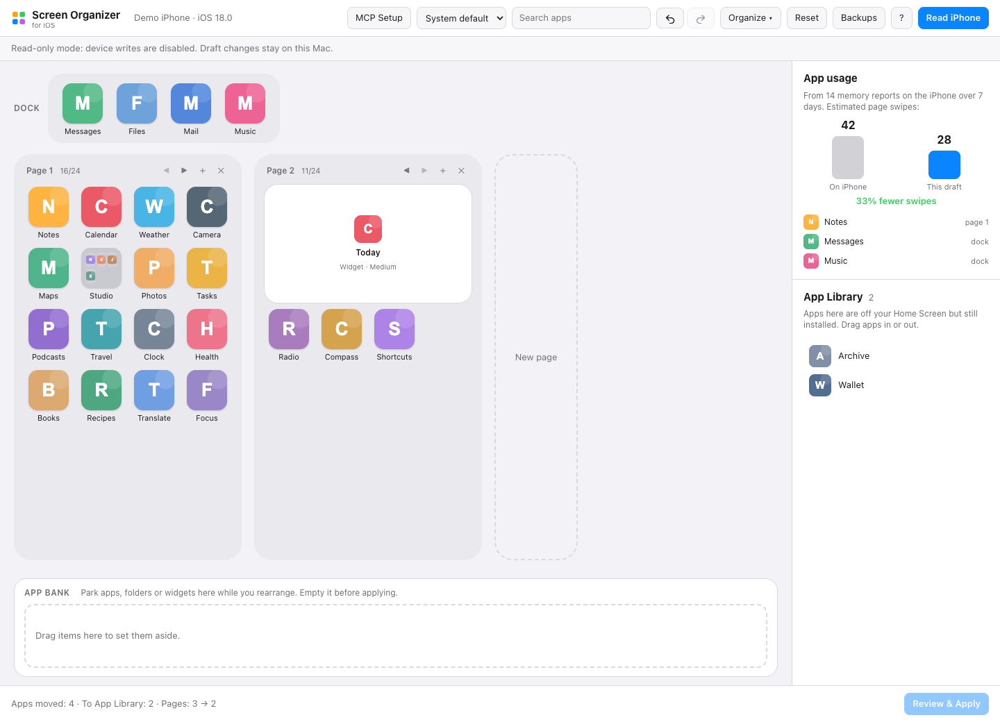

<div align="center">

<h1>Homescreen</h1>
<p><strong>在 Mac 上整理 iPhone 或 iPad 的主屏幕。</strong></p>

**原作：Jonathan Kats · 本仓库为 [kats1123/homescreen-mcp](https://github.com/kats1123/homescreen-mcp) 的独立维护 fork。**

[](LICENSE)
[](macapp/BUILDING.md)
[](macapp/BUILDING.md)

[English](README.md) · **简体中文**

[安装](#install) · [开始使用](#get-started) · [兼容性](#compatibility) · [可选 MCP](#mcp) · [问题反馈](https://github.com/worldsavepoint/homescreen-mcp/issues)

</div>

拖动真实 App 图标，整理文件夹和小组件，按颜色或使用情况排序，预览布局后通过 USB 应用到设备。Homescreen 提供 Mac App、浏览器编辑器、CLI，以及供 AI 助手使用的可选 MCP 服务。免费开源，无需账户或越狱。

本 fork 维护设备会话、备份、本地编辑器和 macOS 启动器的改进。原始应用、界面与 SpringBoard 研究由 **Jonathan Kats 及上游贡献者**完成。本 fork 独立维护。

<picture>
  <source media="(prefers-color-scheme: dark)" srcset="docs/app-dark.png">
  
</picture>

<p align="center"><sub>界面截图来自 Jonathan Kats 的上游 Homescreen 项目。</sub></p>

<a id="features"></a>

## ✨ 功能亮点

- **可视化整理：** 跨页面拖动图标、文件夹、小组件和程序坞项目，支持多选、搜索、撤销/重做，以及按住 ⌥ 拖动交换位置。
- **一键排序：** 按颜色、A–Z、App Store 类别或应用使用情况整理，并估算可减少的翻页次数。
- **整理暂存区：** 将项目暂放在 App Bank，添加、移动或删除页面，编辑包含多页的文件夹。
- **管理 App 资源库：** 将 App 移入或移出资源库；根据已安装应用和可见布局推算资源库内容。
- **预览与应用：** 比较草稿变化，写入前保存对应设备的备份，写入后重新读取结果；比较时包含设备导出的小组件设置。
- **多种操作方式：** Mac App、本地浏览器编辑器、CLI 或 30 个 MCP 工具；草稿与备份按设备分别保存。

<a id="fork-updates"></a>

## 🔧 本 fork 的改进

- **只读会话：** 设置 `HOMESCREEN_READ_ONLY=1` 后，可读取设备并编辑本地草稿；编辑器、CLI 和 MCP 会话中的 Apply 与 Restore 均禁用。
- **设备与备份处理：** Apply 和 Restore 会刷新设备身份与布局、记录备份来源，并核对操作结果。操作中断或结果不符后，需要重新明确执行 Read；本 fork 不恢复缺少设备来源信息的旧备份。
- **本地编辑器与启动器：** 编辑器会话认证、后端健康检查，以及启动器 URL/请求校验。见[本地编辑器 API 参考](docs/LOCAL-EDITOR.md)。
- **源码构建：** 为 macOS arm64 / Python 3.12 固定 Python wheel 版本并校验哈希。见[构建说明](macapp/BUILDING.md)。

<a id="install"></a>

## 📦 从源码安装

需要 **Apple 芯片 Mac、macOS 14+ 和 Python 3.12**。通过 USB 连接 iPhone 或 iPad，并在设备上信任这台 Mac。以下命令使用适用于 **macOS arm64 / CPython 3.12** 的依赖锁；其他平台需要单独解析并验证依赖锁。

```sh
git clone --branch fix/safety-and-readonly-ios18 --single-branch https://github.com/worldsavepoint/homescreen-mcp.git
cd homescreen-mcp
python3.12 -m venv .venv
.venv/bin/python -m pip install --require-hashes --only-binary=:all: -r requirements-build.lock
.venv/bin/python -m pip install --no-deps --no-build-isolation -e .
.venv/bin/python -m pip check
```

以只读模式启动浏览器编辑器：

```sh
HOMESCREEN_READ_ONLY=1 .venv/bin/homescreen ui
```

### 构建 Mac App

安装 Python 3.12 与兼容的 Xcode 命令行工具后，在仓库根目录执行：

```sh
macapp/build.sh
```

脚本使用全新的 Python 环境和同一依赖锁，在 `build/` 中生成 App 和 DMG。构建采用 **ad-hoc 签名**，产物没有 Developer ID 签名或 Apple 公证。详见 [macOS 构建与签名说明](macapp/BUILDING.md)。

**本 fork 尚未发布发行版 DMG。** [上游 Releases](https://github.com/kats1123/homescreen-mcp/releases) 由原项目发布，不包含本 fork 的改动。

<a id="get-started"></a>

## 🚀 开始使用

1. 启动编辑器，通过 USB 连接并解锁 iPhone 或 iPad；出现提示时点击**信任**。
2. 选择设备，点击 **Read**，读取当前布局。
3. 拖动项目、使用排序操作，或将项目暂放在 **App Bank**。应用前，改动保留在本地草稿中。
4. 查看布局差异。只读会话中可以继续浏览和编辑草稿，Apply 与 Restore 均禁用。

需要正常会话时，不设置 `HOMESCREEN_READ_ONLY=1`，直接运行 `.venv/bin/homescreen ui`，或打开已构建的 Mac App。**Review & Apply** 会先保存备份，再将确认后的草稿写入设备。设备验证情况见[兼容性](#compatibility)。

应用布局前，请先在设备上**取消隐藏主屏幕页面**：长按主屏幕，点击页面圆点。USB 不报告隐藏页面和在设备上创建的空位；如需保留这些空位，请在 Homescreen 中重新摆放。见 [USB 布局细节](#usb-details)。

### 按应用使用情况排序

- **设备报告：** iOS 定期生成的内存报告可用于估算应用使用情况，无需额外设置。为通话持续运行或每天常驻内存的 App 权重较低，因为驻留内存不等于主动打开。
- **屏幕使用时间：** 在设备与 Mac 上开启*设置 → 屏幕使用时间 → 在设备之间共享*。读取同步历史需要在*系统设置 → 隐私与安全性*中，为 Homescreen 或运行它的终端授予**完全磁盘访问权限**。

### CLI

安装后，使用 `.venv/bin/homescreen --help` 查看命令：

```text
read · show · diff · preview · apply · backups · restore · diagnose · probe · ui
```

对一台已信任的 USB 设备生成读取兼容性报告：

```sh
HOMESCREEN_READ_ONLY=1 .venv/bin/homescreen diagnose
```

该命令报告版本与布局汇总数量，不创建草稿。

<a id="compatibility"></a>

## 📱 兼容性

- **上游报告：** iPhone 17 Pro Max / iOS 27.0.1、iPhone 17 Pro / iOS 26.6.2、iPad Air 13″ / iPadOS 26.6.2，以及 iOS 27.2 模拟器。这些是上游公布的验证情况，并非本 fork 新增的设备验证。
- **iPad：** 网格、程序坞和文件夹容量由设备提供。上游报告了 MCP/CLI 整理与编辑器绘制 iPad 网格的情况；小组件页面需保持 iPadOS 提供的结构。
- **Python：** 包元数据支持 Python 3.11+，本 fork 提供的构建依赖锁针对 macOS arm64 / Python 3.12。Intel Mac 需要单独解析并验证依赖锁。

USB 不导出完整 App 资源库、已有空位、隐藏页面状态或所有小组件设置。应用布局前，请保留一份归档的设备备份。

<a id="mcp"></a>

## 🔌 可选：使用 AI 助手

MCP 可让助手查看、整理、排序并解释布局。Mac App 配合 Claude Code 时，选择 **Device → Copy MCP Setup Command**，命令指向 App 内置引擎：

```sh
claude mcp add homescreen -- /Applications/Homescreen.app/Contents/Resources/engine/engine mcp
```

使用 Python 安装时，在仓库根目录运行以下命令，使用虚拟环境中的可执行文件：

```sh
claude mcp add homescreen -- "$PWD/.venv/bin/homescreen-mcp"
```

配置 Claude Desktop 的 `claude_desktop_config.json` 时，将 `/path/to/homescreen-mcp` 替换为仓库实际所在的绝对路径：

```json
{
  "mcpServers": {
    "homescreen": {
      "command": "/path/to/homescreen-mcp/.venv/bin/homescreen-mcp",
      "env": { "HOMESCREEN_READ_ONLY": "1" }
    }
  }
}
```

可以尝试：“按颜色整理我的 App”或“把最常用的 App 放到第一页”。助手修改的是草稿。正常会话中，可通过编辑器或 `homescreen apply <token>` 应用草稿。让助手直接发起写入需要设置 `HOMESCREEN_ALLOW_APPLY=1`；设置 `HOMESCREEN_READ_ONLY=1` 时，Apply 与 Restore 始终禁用。

<a id="usb-details"></a>

## 🧠 工作原理

[pymobiledevice3](https://github.com/doronz88/pymobiledevice3) 负责 USB 通信：`com.apple.springboardservices` 读取布局和图标，`installation_proxy` 读取已安装应用。编辑器运行于 `127.0.0.1`，使用认证的本地会话。草稿、备份和图标缓存保存在 `~/Library/Application Support/homescreen-mcp`。

可选的 **Group by App Store category** 操作会先征求同意，再将 bundle ID 发往 Apple 公共查询 API，并缓存结果。屏幕使用时间来自本地同步的 Biome `App.InFocus` 流。翻页估算将第 *N* 页计为 *N−1* 次滑动，再加上文件夹翻页；程序坞不计滑动次数。

<details>
<summary><strong>App 资源库与小组件研究——来自上游项目</strong></summary>

Jonathan Kats 在上游研究中追踪了 iOS 27.2 模拟器的 SpringBoard 导入路径，并在真实设备上检查行为：

1. USB `getIconState` 返回 `[dock, page 1, page 2, …]`；研究检查的各格式版本均不包含 App 资源库。
2. `setIconState` 进入 `-[SBIconController importIconState:]`；`+[SBIconStateArchiver rootArchiveFromITunesRepresentation:]` 仅将列表转换为 `buttonBar` 和 `iconLists`。
3. 列表未提及的 App 可能被放到主屏幕页面。上游曾观察到写回未修改的列表后，33 个资源库 App 出现在主屏幕上。

Homescreen 因此使用 SpringBoard 的字典形式：`buttonBar`、`iconLists`，以及存放资源库项目的 `ignored`。后者通过已安装应用（含已卸载但保留数据的 App）减去主屏幕应用、隐藏与仅供系统使用的应用推算。移动项目时保留 App、文件夹数据及未知字段。

**小组件：** 配置关联到元素 ID，USB 以 `userSelectedElementIdentifier` 导出。Homescreen 将其作为 `uniqueIdentifier` 写回，并跨读取记住 ID。上游在 iOS 27.0.1 上验证了 Scriptable 小组件写入后仍保留所选脚本；USB 未导出的设置无法比较。

**网页快捷方式：** 已安装应用列表不包含这类项目，USB 也不报告资源库中的网页快捷方式。Homescreen 按设备记住曾经读取的快捷方式，并将其放入 `ignored`。若写入后出现此前未知的快捷方式，结果会在 `hidden_webclips` 中列出；上游在 iOS 26.6.2 上记录了将其移回资源库后再次应用的处理方式。

上游实现会在需要保留设备现值时省略 Today View 和页面 ID 键。模拟器研究工具位于 [`tools/sbhelper/`](tools/sbhelper/README.md)，原始研究见[上游项目](https://github.com/kats1123/homescreen-mcp)。

</details>

<details>
<summary><strong>空位、隐藏页面与布局校验</strong></summary>

iOS 在 `listMetadata` → `fixedLocations` 中按页面 ID 保存固定空位。USB 布局导出只提供图标顺序，不含这些空位或隐藏页面状态。写入时缺少空位元数据会清除空位，包括未编辑页面上的空位。

- Homescreen 按设备记住编辑器中创建的空位，并在写入时发送页面 ID 与固定位置。上游在 iOS 27.0.1 和 iOS 27.2 模拟器上检查了这一行为。
- 设备上创建的空位无法读取，首次应用后会收拢。可在编辑器中将 App 拖到目标空位置，重新建立布局。
- 应用前取消隐藏主屏幕页面，因为 USB 不提供哪些页面被隐藏的信息。

布局校验涵盖页面/程序坞/文件夹容量、项目重复或丢失、文件夹中的嵌套文件夹或小组件，以及 App Bank 是否已清空。iPhone 的 4×6 页面有 24 格，小/中/大小组件占 4/8/16 格，程序坞容纳 4 个 App，文件夹每页容纳 9 项。iPad 使用设备提供的容量；上游的 iPad Air 13″ 报告了 5×6 网格、26 个程序坞 App 和每页 16 项的文件夹。

不会在主屏幕显示的系统应用列在 [`homescreen/device.py`](homescreen/device.py) 的 `NEVER_ON_HOME_SCREEN` 中。如果 `added_by_ios` 报告了意外的系统 App，可能需要更新该列表。

</details>

<a id="development"></a>

## 🛠️ 开发

按前文完成源码安装后，运行仓库检查：

```sh
.venv/bin/python -m pytest -q tests
```

使用示例布局探索编辑器：

```sh
.venv/bin/python tests/fake_phone.py fake.plist --dict
HOMESCREEN_FIXTURE=fake.plist .venv/bin/homescreen ui
```

或使用已启动的模拟器：

```sh
HOMESCREEN_SIM=booted .venv/bin/homescreen ui
```

参考：[macOS 构建与依赖锁](macapp/BUILDING.md) · [本地编辑器会话与 API](docs/LOCAL-EDITOR.md) · [兼容性检查](docs/COMPATIBILITY.md)。

<a id="credits"></a>

## 🤝 致谢与支持

**Jonathan Kats** 创建了 Homescreen。原始 Mac App、编辑器、截图和 SpringBoard 研究的贡献归属于[上游项目](https://github.com/kats1123/homescreen-mcp)及其贡献者。感谢 [pymobiledevice3](https://github.com/doronz88/pymobiledevice3) 提供 USB 设备通信接口。

- **本 fork：** [源码与改动](https://github.com/worldsavepoint/homescreen-mcp/tree/fix/safety-and-readonly-ios18) · [问题反馈与支持](https://github.com/worldsavepoint/homescreen-mcp/issues)。
- **原始项目：** [上游源码](https://github.com/kats1123/homescreen-mcp) · [上游问题反馈与支持](https://github.com/kats1123/homescreen-mcp/issues) · [上游发行版](https://github.com/kats1123/homescreen-mcp/releases)。

本 fork 的问题请附 macOS/iOS 版本、安装方式、复现步骤和脱敏后的错误信息。

<a id="license"></a>

## 📄 许可证

[MIT](LICENSE)。Copyright © 2026 Jonathan Kats。保留原始许可证与版权声明。

Homescreen 与 Apple Inc. 无关联，也未获其认可或赞助。iPhone、iOS 和屏幕使用时间是 Apple 的商标。项目使用的私有设备接口行为可能随 iOS 更新而变化。
